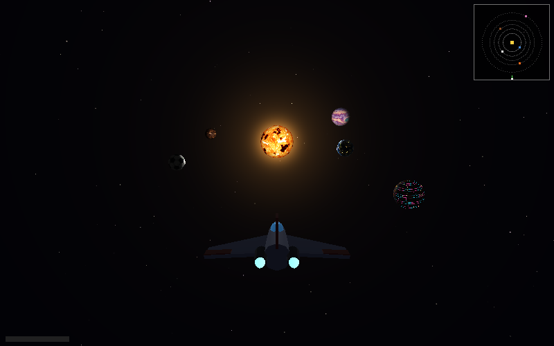
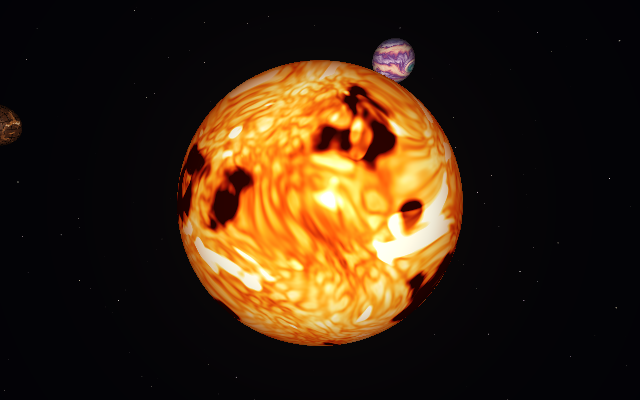
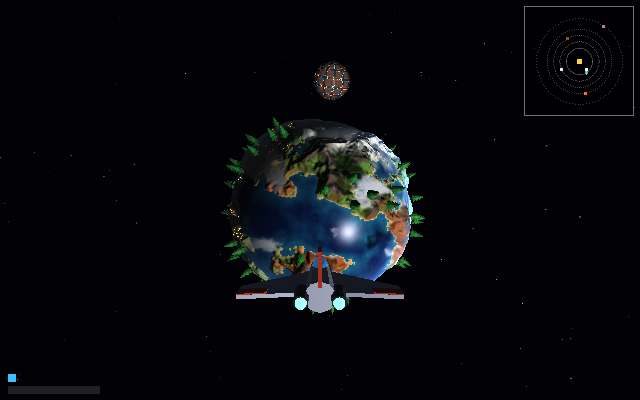
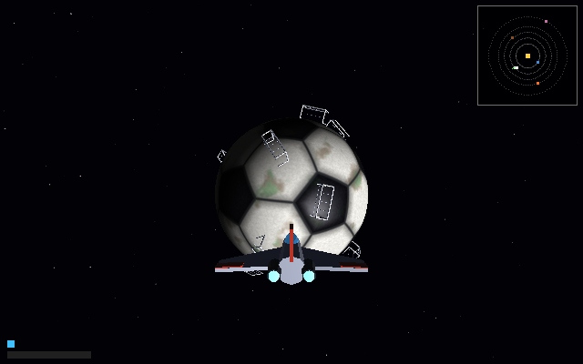
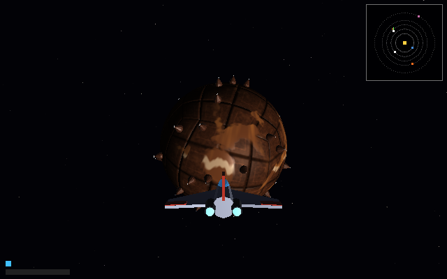
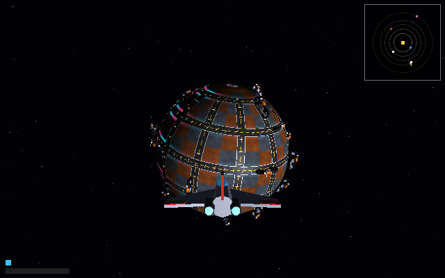
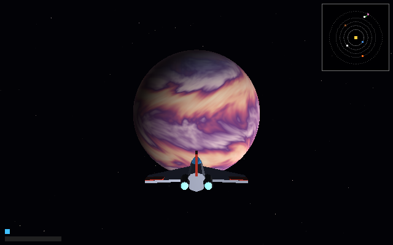

# Sistema solar explorable — Proyecto final de Gráficos por Computadora

**Software Renderer en CPU, escrito en Rust.**
Un pequeño sistema solar con un sol, cinco planetas con identidad propia y una nave que se controla en
tiempo real. Se puede cruzar el sistema, acercarse a la superficie de cualquier planeta, rodearlo y alejarse,
**sin pantallas de carga ni cambios de escena**.



> **Integrantes y contribuciones** _(completar: una línea por persona con su contribución técnica concreta)_
>
> | Integrante | Contribución técnica |
> |---|---|
> | _Nombre 1_ | _p. ej. rasterizador, z-buffer y recorte_ |
> | _Nombre 2_ | _p. ej. shaders de planetas y distribución procedural_ |
> | _Nombre 3_ | _p. ej. nave: física, gravedad, colisión y controles_ |
>
> **Video del recorrido:** `docs/recorrido.mp4` (vuelo espacial → acercamiento → vuelta alrededor de un planeta → alejamiento).

---

## 1. Cómo ejecutar

Solo hace falta [Rust](https://rustup.rs) (instalado con `rustup`).

```bash
cargo run --release
```

> Usa siempre `--release`: sin optimizaciones el renderer es mucho más lento.
> En Linux puede hacer falta `sudo apt install libx11-dev libxkbcommon-dev libwayland-dev`.

Opciones útiles:

| Comando | Qué hace |
|---|---|
| `cargo run --release -- --demo` | Empieza con el **recorrido automático** (sirve para grabar el video) |
| `cargo run --release -- --width 320 --height 200` | Menos resolución = más fluido si tu computadora es lenta |
| `cargo run --release -- --seed 7` | Otra distribución de objetos en los planetas |
| `cargo run --release -- --save foto.png --focus 4 --dist 2` | Guarda una imagen sin abrir ventana (`--focus 0` sol, `1..5` planetas) |
| `cargo run --release -- --save a.png --focus 1 --no-cull --no-lod` | Igual, pero apagando descarte y LOD (para comparar contadores) |
| `cargo test --release` | Pruebas automáticas (física, colisión, órbitas, semilla) |

### Cómo grabar el video
* **Opción fácil:** abre el programa con `--demo` y graba la ventana con OBS (o la grabadora de tu sistema).
* **Sin ventana (con ffmpeg):**
  ```bash
  cargo run --release -- --pipe --width 560 --height 350 --fps 30 | \
    ffmpeg -f rawvideo -pix_fmt rgb24 -s 560x350 -r 30 -i - -c:v libx264 -pix_fmt yuv420p recorrido.mp4
  ```
  Dibuja cuadro por cuadro con un tiempo fijo, así que el video sale fluido aunque tu computadora sea lenta.

---

## 2. Controles

| Tecla | Acción |
|---|---|
| `W` / `S` | Acelerar / retroceder |
| `A` / `D` | Moverse a la izquierda / derecha |
| `R` / `F` | Subir / bajar |
| `↑` `↓` | Cabeceo (nariz arriba / abajo) |
| `←` `→` | Girar a la izquierda / derecha |
| `Q` / `E` | Alabeo (inclinar la nave) |
| `Shift` | Impulso (boost) |
| `Espacio` | Frenar |
| `V` | Cámara: tercera persona / primera persona |
| `Tab` | Recorrido automático (activar / detener) |
| `G` | Gravedad (activar / desactivar) |
| `L` | Modo de control local (activar / desactivar) |
| `K` | Descarte de objetos fuera de vista (activar / desactivar) |
| `O` | Niveles de detalle, LOD (activar / desactivar) |
| `P` | Pausa del tiempo |
| `T` | Velocidad del tiempo ×1 / ×4 / ×16 (para ver las órbitas) |
| `Y` | Cambiar la semilla de distribución de objetos |
| `M` | Mostrar / ocultar el radar |
| `Z` | Calidad de shaders alta / rápida |
| `Enter` | Guardar captura en `capturas/` |
| `H` | Imprimir la ayuda en la consola |
| `Esc` | Salir |
| `0`–`5` | *Atajo de desarrollo:* ir cerca del sol (0) o de un planeta (1–5). **No usar en el video.** |

**Pantalla:** el radar (arriba a la derecha) muestra el sistema visto desde arriba (la nave en blanco con una línea
verde hacia donde mira). La barra inferior es la velocidad; el cuadro azul aparece cuando el **modo local** está
activo. El **título de la ventana** muestra fps, velocidad, planeta más cercano y su altura, y los contadores de
objetos y triángulos.

---

## 3. Requisitos obligatorios (dónde verlos)

| # | Requisito | Dónde / cómo |
|---|---|---|
| 1 | Pipeline de software propio | `src/renderer.rs` (transformación, recorte, rasterización, z-buffer, sombreado) y `src/math.rs`. La librería de ventana solo abre la ventana, lee teclas y muestra el framebuffer (`src/window.rs`). No se usa ninguna función 3D, cámara, modelo ni shader de librerías. |
| 2 | Sol, nave modelada por nosotros y planetas; órbita y rotación por **tiempo** | `src/game.rs` (`planet_defs`, `planet_pos_at`, `planet_axes_at`): las posiciones son funciones del tiempo transcurrido, no de los cuadros (prueba `orbita_depende_del_tiempo`). Nave: `assets/models/ship.obj` |
| 3 | Acercarse a un planeta y alejarse sin transición, con cámara orientable | Se vuela de forma continua hasta pocas unidades de la superficie. Modo local + LOD hacen que se vea bien de cerca (`src/ship.rs`, `src/game.rs`) |
| 4 | Modelos con matrices modelo-vista-proyección, z-buffer y shader de fragmentos propio | `Mat4::model`, `view_matrix`, `perspective` en `src/math.rs`; z-buffer en `Renderer::fill`; shaders en `src/shaders/` |
| 5 | Código, modelos, instrucciones y video | Este repositorio, `assets/models/`, sección 1 y `docs/recorrido.mp4` |

---

## 4. Características del menú que solicitamos evaluar

| Característica | Pts | Dónde verlo / archivo |
|---|:---:|---|
| **Planetas distinguibles** (5: Terra Vitae, Futbolandia, Cacaolandia, Motoplaneta, Nebulosa Magna) | 50 | Tecla `1`–`5` o volar hacia ellos; `src/game.rs` (`planet_defs`) |
| **Tipos de modelo sobre planeta** (árbol, portería, chocolate "kiss", motocicleta) | 20 | Terra Vitae, Futbolandia, Cacaolandia, Motoplaneta; `assets/models/` |
| **Distribución procedural reproducible** (ruido + semilla fija/configurable) | 10 | `distribute()` en `src/game.rs`; `--seed N` o tecla `Y` |
| **Posición y orientación sobre superficie curva mientras rota** | 5 | Los objetos usan la normal del terreno y la rotación del planeta (`Game::draw_items`) |
| **Shaders propios** (distintos entre sí) | 24 | `src/shaders/` (sección 5) |
| **Shader animado** | 8 | Sol, Cacaolandia (goteo), Motoplaneta (motos de luz), Nebulosa Magna |
| **Deformación de la geometría con ruido** | 10 | Montañas reales en Terra Vitae: `rocky::displacement` aplicada en `mesh::icosphere` |
| **Etapa propia de generación/subdivisión de geometría** | 10 | `mesh::icosphere`: subdivisión de un icosaedro, niveles 2 a 5 (320 a 20 480 triángulos) |
| **Modo de control local** | 8 | Cerca de un planeta (cuadro azul del HUD): la nave viaja con él, su "arriba" se alinea con la superficie y la velocidad máxima baja con la altura (`Ship::step`, `Game::update`). Tecla `L` |
| **Aceleración, frenado y giro progresivos, consistentes entre equipos** | 8 | `Ship::step` usa pasos de tiempo pequeños con `dt`; prueba `fisica_independiente_de_los_fps` (30 fps vs 144 fps) |
| **Atracción gravitatoria** | 10 | `Ship::step`: sol y planetas atraen la nave (tecla `G` para comparar) |
| **Colisión básica** | 4 | La nave y la cámara no atraviesan el sol ni los planetas (prueba `colision_con_planeta`) |
| **Descarte de objetos fuera de la vista** | 7 | Esfera envolvente contra el frustum + back-face culling + recorte contra el plano cercano; tecla `K` |
| **Niveles de detalle según la distancia** | 8 | Planetas y objetos de superficie: `Game::lod_index`; tecla `O` |

*(Presentación: se deja a criterio del profesor.)*

### Contadores de descarte y LOD (generados con `--save ... --no-cull --no-lod`)

Triángulos que procesa el renderer según la vista y las optimizaciones activas:

| Vista | Con descarte + LOD | Sin descarte | Sin LOD | Sin ninguno |
|---|---:|---:|---:|---:|
| Vista general (inicio) | **2 388** | 2 388 | 164 140 | 164 140 |
| Cerca de Terra Vitae | **29 480** | 51 880 | 70 520 | 163 672 |
| Cerca del Motoplaneta | **37 880** | 44 880 | 37 880 | 163 672 |

Con el programa abierto, `K` y `O` cambian estos números en vivo (título de la ventana: `obj dibujados/totales`
y `tri` rasterizados). En la vista general el LOD reduce el trabajo ~70 veces; el descarte quita los objetos
detrás o a los lados de la cámara.

---

## 5. Los cuerpos y sus shaders

Todos son *fragment shaders* propios: funciones `fn(&Fragment, &Uniforms) -> Vec3` que reciben los datos de un
pixel y devuelven su color. Se calculan en el **espacio del planeta**, así que los patrones giran con él.

| Cuerpo | Shader | Qué hace (y cómo) |
|---|---|---|
|  **Sol** | `star.rs` | Emite luz propia. Temperatura calculada con ruido deformado en el tiempo (hierve), granulación con `abs(ruido)`, manchas, erupciones y oscurecimiento del borde. **Animado.** |
|  **Terra Vitae** | `rocky.rs` | Océano brillante, tierra mate, nieve, nubes que se mueven aparte, sombras de nubes, relieve (bump) y parallax. Su geometría se **deforma** con ruido para que las montañas sobresalgan. |
|  **Futbolandia** | `football.rs` | Balón gigante: cada pixel calcula a qué cara de un icosaedro truncado (12 pentágonos + 20 hexágonos) pertenece y qué tan cerca está de la costura; costuras, "inflado" de los paneles, pasto y tierra con ruido. |
|  **Cacaolandia** | `chocolate.rs` | Tabletas con ranuras biseladas (cuadrícula en las 6 caras de un cubo + inclinación de la normal). El chocolate se **derrite del lado que mira al sol** (la zona sigue al sol mientras el planeta rota); lo líquido es liso, brillante y gotea con el tiempo. **Animado.** |
|  **Motoplaneta** | `moto_planet.rs` | Red de carreteras (meridianos y paralelos con ancho constante), línea amarilla discontinua, bloques de ciudad, neón que brilla de noche y "motos de luz" que recorren las carreteras. Las motocicletas 3D se colocan sobre las carreteras y orientadas a lo largo de ellas. **Animado.** |
|  **Nebulosa Magna** | `gas_giant.rs` | Bandas líquidas (deformación de dominio doble y desplazamiento distinto por latitud) y tormenta que **curva** las bandas girando las coordenadas. **Animado.** |
| Nave y objetos | `solid.rs` | Color de cada material del `.mtl`, luz del sol difusa + especular + borde; el fuego de los motores es emisivo y parpadea. |

### Parámetros que se pueden cambiar (para la demostración)
* **Planetas:** `planet_defs()` en `src/game.rs` — `radius`, `orbit_radius`, `orbit_period` (velocidad orbital), `spin_period`, `tilt`.
* **Sol:** `SUN_RADIUS` en `src/game.rs`.
* **Semilla de objetos:** `--seed N` o tecla `Y`. Cantidad y tamaño: `PropDef` de cada planeta.
* **Shaders:** constantes al inicio de cada archivo de `src/shaders/` (p. ej. `MELT_BIAS` en el chocolate, `SEAM_WIDTH` en el balón, `ROAD_HALF_WIDTH` en el Motoplaneta, `STORM_SWIRL` en el gigante gaseoso).
* **Nave:** `ACCEL`, `MAX_SPEED`, constantes de giro en `src/ship.rs`; gravedad `gm` en `Game::bodies`.

---

## 6. Estructura del proyecto

```
src/main.rs            Ventana, modos --save / --record / --pipe, argumentos
src/window.rs          ÚNICO archivo que usa la librería de ventana (minifb)
src/game.rs            Sistema solar: planetas, órbitas, objetos de superficie, LOD, cámara, piloto automático
src/ship.rs            Nave: física, gravedad, colisión, modo local
src/renderer.rs        Pipeline: descarte, transformación, recorte, rasterización, z-buffer, sombreado
src/mesh.rs            Carga de .obj/.mtl y generación de esferas por subdivisión (con deformación)
src/math.rs            Vectores, matrices, cámara, perspectiva
src/noise.rs           Ruido 3D de gradiente propio + fbm
src/hud.rs             Radar, barra de velocidad
src/shaders/           Un archivo por shader (sol, planetas, objetos sólidos)
assets/models/         ship, moto, goal, kiss, tree (.obj + .mtl)
tools/gen_models.py    Script que generó la primera versión de los modelos
docs/                  Capturas y video
```

**El pipeline en un cuadro:** `Game::update(dt)` mueve planetas y nave → `Game::draw_items` elige el nivel de detalle y
arma la lista de objetos → `Renderer::render`: descarta objetos fuera del frustum → transforma vértices con
proyección·vista·modelo → back-face culling y recorte contra el plano cercano → rasteriza con coordenadas
baricéntricas y z-buffer compartido → **sombrea solo los píxeles visibles** llamando al fragment shader de cada objeto.

---

## 7. Recursos externos y asistencia de IA

* **Asistencia de IA:** se usó un LLM (Claude) como apoyo para estructurar el proyecto, escribir la primera versión del
  código y generar los modelos iniciales con un script. _(Completar con sus palabras: qué partes entendieron y
  modificaron, qué cambios propios hicieron. Todos los integrantes deben poder explicar el código.)_
* **Librerías:** [`minifb`](https://crates.io/crates/minifb) solo para la ventana, el teclado y mostrar el framebuffer.
  El resto (matemáticas, ruido, rasterizador, escritor de PNG) está escrito en este repositorio.
* **Modelos:** `assets/models/*.obj` fueron generados por `tools/gen_models.py` como punto de partida.
  _(Indicar aquí cuáles modificaron en Blender y cómo.)_
